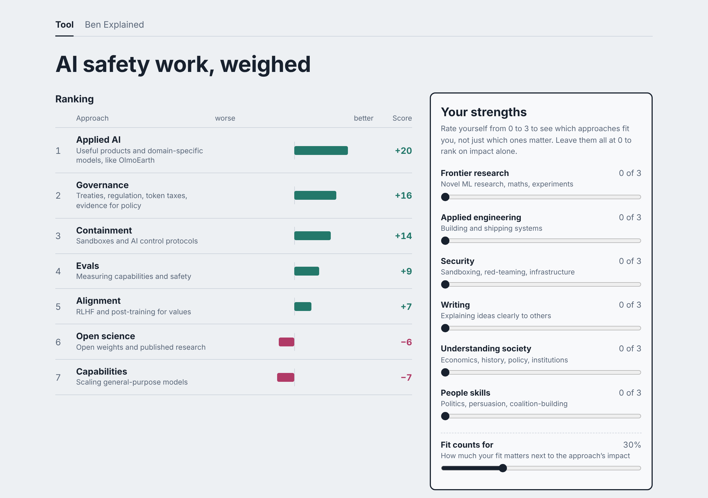
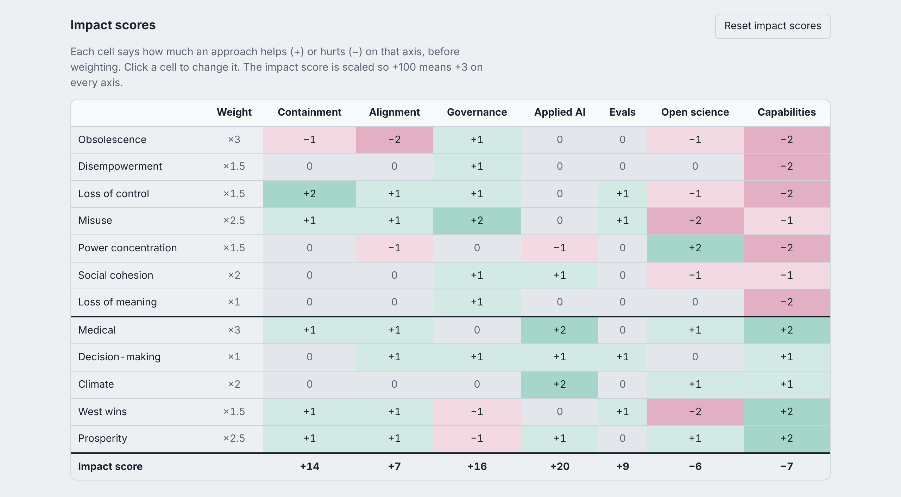
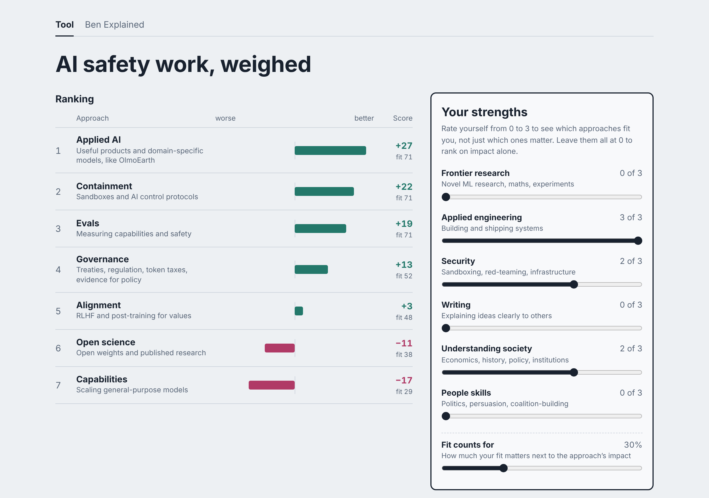
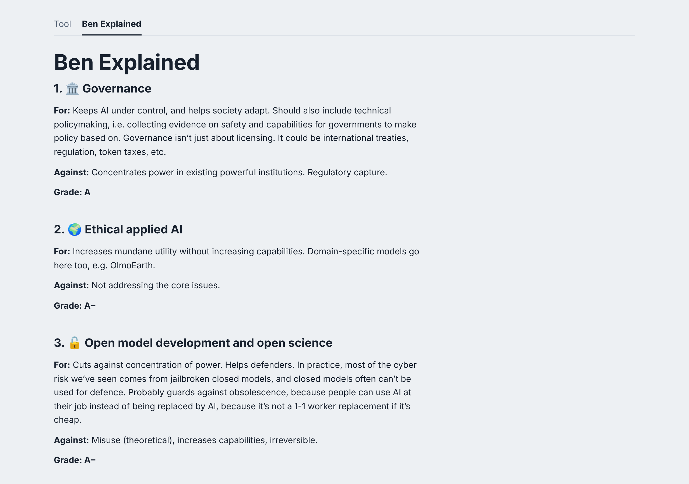
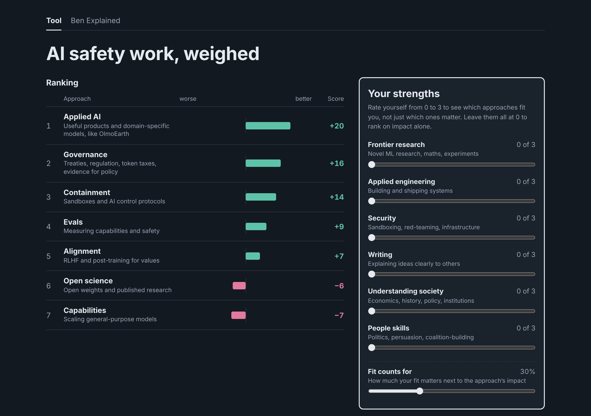

# AI-Ethics-Ranking
An interactive tool to determine the best thing you can do about AI based on your own values.

## How it works
The tool ranks seven kinds of AI work: governance, applied AI, open science, containment, evals, alignment and capabilities.

Each one is scored from −3 to +3 on seven harms and five benefits. The harms are obsolescence, disempowerment, loss of control, misuse, power concentration, social cohesion and loss of meaning. The benefits are medical, decision-making, climate, West wins and prosperity.

You set how much each harm and benefit matters to you. The ranking updates as you drag.

Don't agree with a score? Click any cell and change it.

## Your strengths
You can also rate yourself from 0 to 3 on six strengths: frontier research, applied engineering, security, writing, understanding society and people skills. The tool then blends how well each approach fits you with how much good it does. The "fit counts for" slider sets the mix.

## Ben Explained
The second tab is my own take on each approach, with the case for and against and a grade.

## Running it
It's one HTML file with no build step. Open it in a browser, or serve it with GitHub Pages.

Your weights, scores and strengths are saved in your browser's local storage. Nothing gets sent anywhere.

